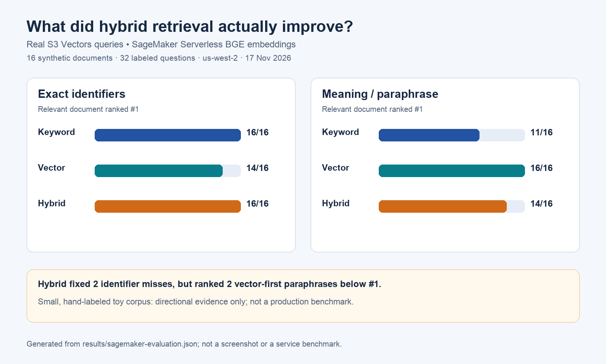
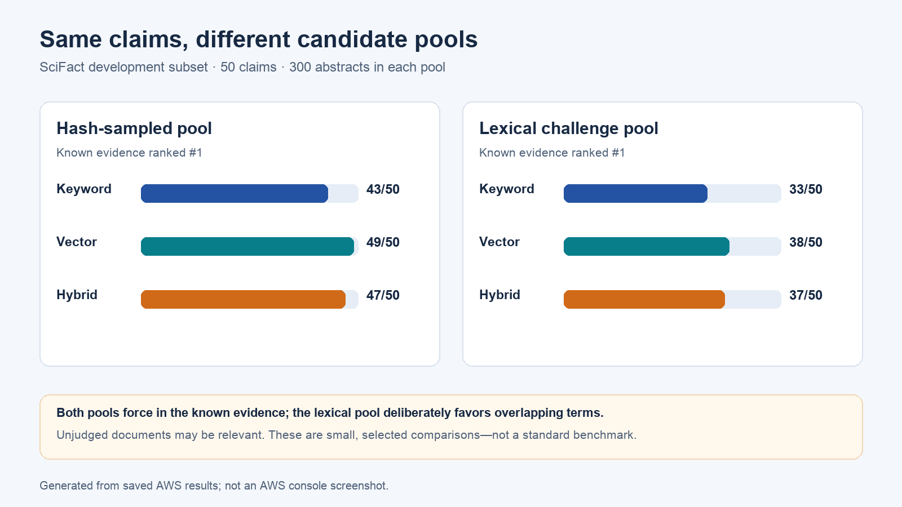

# Benchmark appendix

This appendix preserves the detailed experiments behind the accompanying tutorial. These are diagnostic, constructed evaluations, not production claims. The [companion repository](https://github.com/ayogun/ai-support-engine/tree/caea3bface4d293f3d5453e5e9f0fbc1963e4d96) contains the implementation and saved results. Run the optional datasets one at a time after the base lab is ready, and clean up afterward.

## Synthetic baseline

Run the same evaluation against the deployed model and index:

```bash
PYTHONPATH=src:. python -m scripts.smoke_test results/my-smoke.json
PYTHONPATH=src:. python -m scripts.inspect_ingestion results/my-ingestion.json
PYTHONPATH=src:. python -m scripts.evaluate --embedding sagemaker \
  --output results/my-evaluation.json
```

The evaluator uses [16 synthetic documents](https://github.com/ayogun/ai-support-engine/tree/caea3bface4d293f3d5453e5e9f0fbc1963e4d96/fixtures/documents) and [32 labeled questions](https://github.com/ayogun/ai-support-engine/blob/caea3bface4d293f3d5453e5e9f0fbc1963e4d96/fixtures/queries.json): 16 ask about an identifier and 16 paraphrase a document. Each question has a hand-specified relevant document. It checks the index configuration and expected vector keys, waits for identifiers to be text-searchable, embeds the questions using the deployed endpoint, and makes separate keyword, vector, and hybrid requests with `topK=3`.

**Hit@1** is the number of questions whose relevant document is ranked first. **Hit@3** counts one anywhere in the first three. **MRR@3** averages `1/rank`, counting a miss outside the top three as zero. Here are the saved results:

| Retrieval mode | Identifier hit@1 | Paraphrase hit@1 | Overall hit@1 | Overall hit@3 | MRR@3 |
|---|---:|---:|---:|---:|---:|
| Keyword | 16/16 | 11/16 | 27/32 | 31/32 | 0.9062 |
| Vector | 14/16 | 16/16 | 30/32 | 32/32 | 0.9688 |
| Hybrid | 16/16 | 14/16 | 30/32 | 32/32 | 0.9635 |



*Generated from the saved evaluation; not a console screenshot or a production benchmark.*

Two examples show why the aggregate matters less than the failure modes:

- **`Find RETURN301`:** vector search returned `return302` first and the relevant `return301` second. Hybrid returned `return301` first.
- **“My order is still waiting to leave the warehouse.”** Vector search returned the relevant `ship802` first. Hybrid returned it third, behind `ship801` and `order602`.

The saved responses make the second failure concrete:

| Document | Keyword-only rank | Vector-only rank | Hybrid fused score | Hybrid rank |
|---|---:|---:|---:|---:|
| `ship801` | 2 | 3 | 0.03252 | 1 |
| `ship802` (labeled relevant) | Outside top 3 | 1 | 0.01667 | 3 |

In these separate top-three responses, `ship801` contributed to **both** rankings, while `ship802` appeared only in the vector contribution returned for the hybrid result. Reciprocal-rank fusion rewarded the former's agreement across lists. The #2 hybrid result, `order602`, also scored about 0.01667, tied with `ship802`; don't infer a stable ordering from that tie. The [query-level data](https://github.com/ayogun/ai-support-engine/blob/caea3bface4d293f3d5453e5e9f0fbc1963e4d96/results/2026-11-18-synthetic.json) contains the component scores. This is a ranking trade-off, not proof that the service should always favor one mode.

On this toy dataset, hybrid corrected two identifier misses at rank one but pushed two paraphrases that vector search got right below rank one. Both vector and hybrid found every relevant document within the top three, yet vector's MRR@3 was slightly higher. The documents, questions, and labels were authored for this demonstration, so let's also try labels created independently of this article.

The JSON also records query timings, but they measure **direct, sequential S3 Vectors calls** from one client after question embeddings were created. They exclude endpoint inference and API Gateway, so they are not end-to-end search latency or a load test.

## Independent science labels and why the candidate pool matters

The independent labels come from [SciFact](https://github.com/allenai/scifact), created by Wadden and colleagues for [scientific claim verification](https://aclanthology.org/2020.emnlp-main.609/). For retrieval, I count an abstract annotated as either **SUPPORT** or **CONTRADICT** as known evidence for its claim; the task is to find evidence, not decide whether the claim is true. The source [licenses](https://github.com/allenai/scifact/blob/master/LICENSE.md) distinguish claims from abstracts.

Run the comparisons one after another, not alongside ingestion or a latency test:

```bash
PYTHONPATH=src:. python -m scripts.evaluate_scifact --pool random \
  --output results/my-scifact-random.json
PYTHONPATH=src:. python -m scripts.evaluate_scifact --pool lexical \
  --output results/my-scifact-lexical.json
```

The [evaluator](https://github.com/ayogun/ai-support-engine/blob/caea3bface4d293f3d5453e5e9f0fbc1963e4d96/scripts/evaluate_scifact.py) downloads the original archive and verifies its SHA-256. From 300 development claims, it selects 50 of the 188 with usable annotated evidence by a fixed hash order. It puts **all 52 known evidence abstracts** for those claims into each 300-document pool. It fills the remaining 248 slots in two different ways:

- **Hash-sampled pool:** deterministically select other eligible abstracts from the 5,183-document source corpus.
- **Lexical challenge pool:** score eligible abstracts against the selected claims using a small local BM25 implementation, then round-robin high-overlap candidates across claims. This is a deliberately biased stress test, not S3 Vectors' own text analyzer.

For each pool, the script builds a separate enhanced index, embeds the abstracts and claims with the **same SageMaker endpoint**, and sends keyword, vector, and hybrid queries with `topK=3`. It writes these evaluation vectors directly to S3 Vectors; the 16-document smoke test, not the SciFact experiment, verifies the S3-to-Lambda ingestion path. A fresh pool makes 350 model calls and 150 direct vector-index queries. Partial retries verify existing vector fingerprints before reuse.

| Candidate pool | Mode | Known-evidence hit@1 | Hit@3 | MRR@3 |
|---|---|---:|---:|---:|
| Hash-sampled | Keyword | 43/50 | 48/50 | 0.9100 |
| Hash-sampled | Vector | 49/50 | 50/50 | 0.9867 |
| Hash-sampled | Hybrid | 47/50 | 50/50 | 0.9700 |
| Lexical challenge | Keyword | 33/50 | 43/50 | 0.7500 |
| Lexical challenge | Vector | 38/50 | 45/50 | 0.8233 |
| Lexical challenge | Hybrid | 37/50 | 44/50 | 0.8033 |



*Generated from the saved AWS results; not a console screenshot.*

The [hash-sampled](https://github.com/ayogun/ai-support-engine/blob/caea3bface4d293f3d5453e5e9f0fbc1963e4d96/results/2026-11-18-scifact.json) and [lexical-challenge](https://github.com/ayogun/ai-support-engine/blob/caea3bface4d293f3d5453e5e9f0fbc1963e4d96/results/2026-11-18-scifact-lexical.json) reports contain the selected IDs, labels, ranks, model revision, data hashes, and per-query scores. On the first pool, vector and hybrid both put known evidence first for 46 claims; vector alone did so for three and hybrid alone for one. On the lexical pool, those paired counts were 34, four, and three; neither did so for nine. One claim represents two percentage points in this sample. A [repeat of the hash-sampled run](https://github.com/ayogun/ai-support-engine/blob/caea3bface4d293f3d5453e5e9f0fbc1963e4d96/results/2026-11-18-scifact-repeat.json) produced the same aggregate rankings; it reused the same index and claims, so it checks repeatability, not generalization.

**Do not turn this into a leaderboard.** The pools force annotated evidence into a tiny subset, and the second is chosen for lexical overlap. Other abstracts may be relevant but unjudged, so a result not in the evidence labels is counted as a miss, not proven irrelevant. Claims without annotated evidence are excluded: this is not a no-answer test. The development split is held out from SciFact's training split, but whether the embedding model saw any of these data during its own training is unknown. These results do not estimate retrieval quality for all 5,183 abstracts, a production support corpus, or other languages.

## A support-shaped external check, not a relevance benchmark

SciFact does not resemble a customer-support knowledge base. As an additional, independently authored check, I used [Bitext's synthetic customer-support dataset](https://huggingface.co/datasets/bitext/Bitext-customer-support-llm-chatbot-training-dataset), which contains generated instruction/response pairs and intent labels. Its source is licensed under [CDLA-Sharing-1.0](https://cdla.dev/sharing-1-0/); the evaluator downloads a pinned revision, checks its SHA-256, and caches the CSV locally rather than distributing it in the companion archive.

```bash
PYTHONPATH=src:. python -m scripts.evaluate_bitext \
  --output results/my-bitext-support.json
```

From the 27 labeled intents, the [evaluator](https://github.com/ayogun/ai-support-engine/blob/caea3bface4d293f3d5453e5e9f0fbc1963e4d96/scripts/evaluate_bitext.py) selects ten distinct response texts as searchable documents and two different instruction rows as questions per intent: **270 documents and 54 questions**. It excludes exact duplicates of the selected document rows' instructions from the questions and uses deterministic hash ordering. It writes these vectors directly to another index and appends unique readiness markers before embedding. A result counts as a hit if its response row has the same intent as the question; each question therefore has ten same-intent candidates.

| Mode | Same-intent hit@1 | Same-intent hit@3 | Same-intent MRR@3 |
|---|---:|---:|---:|
| Keyword | 39/54 | 48/54 | 0.7963 |
| Vector | 46/54 | 52/54 | 0.9012 |
| Hybrid | 45/54 | 52/54 | 0.8981 |

The [recorded report](https://github.com/ayogun/ai-support-engine/blob/caea3bface4d293f3d5453e5e9f0fbc1963e4d96/results/2026-11-18-bitext-support.json) contains selected row IDs, labels, ranks, and data/model fingerprints, not the source CSV. **Same intent is only a proxy for relevance:** a same-intent response may be generic or wrong for a particular request, and another intent's response may be useful. The questions and answers are synthetic and may share templates or near-duplicates despite row holdout; the balanced sample is not real traffic, and model-training overlap is unknown. This is a more support-shaped diagnostic, not validation against an actual support corpus. For a deployment decision, collect representative user questions, judge candidate documents independently, and include no-answer cases.

## Historical technical-support questions: TechQA

The [TechQA-RAG-Eval dataset](https://huggingface.co/datasets/nvidia/TechQA-RAG-Eval) is a reduced derivative of [IBM TechQA](https://aclanthology.org/2020.acl-main.117/); its publisher describes real developer-forum questions whose accepted answers linked to technical documents. I treat that originally linked document as a known positive, not as a new independent relevance judgment. The publisher labels its derivative Apache-2.0; review the original source terms and your requirements before reuse. Model training overlap is unknown.

Run the [evaluator](https://github.com/ayogun/ai-support-engine/blob/caea3bface4d293f3d5453e5e9f0fbc1963e4d96/scripts/evaluate_techqa.py) by itself, after other model work has stopped:

```bash
PYTHONPATH=src:. python -m scripts.evaluate_techqa --output results/my-techqa-support.json
python -m scripts.compare_results results/my-techqa-support.json --output results/my-techqa-paired.json
```

The script downloads the questions and corpus from the pinned dataset revision and verifies both SHA-256 hashes. The archive is read without extracting source files; neither source text nor the archive is redistributed here. Among 310 development questions, 160 are marked answerable and 150 unanswerable; the latter are excluded, so this is not an abstention test. The lab's 1,000-byte query and 8,000-byte document limits leave 139 eligible answerable questions. A fixed hash ordering chooses 100 with distinct linked documents. All 100 linked documents are forced into the index, then 500 other eligible documents are hash-sampled; this is a constructed pool, not the original full 28,481-document corpus. The script appends unique readiness markers, indexes each document using the same SageMaker model, verifies text-search readiness, and sends the same queries directly to all three retrieval modes with `topK=3`. It records IDs, ranks, timings, fingerprints, and source checksums, but not source question or document text. At least 700 model invocations and 900 vector queries are required, plus writes, reads, and potential repeated readiness checks. My cached-data run took about 12.6 minutes, excluding the dataset download, deployment, and cleanup; your time will vary.

| Mode | Linked-document hit@1 | Hit@3 | MRR@3 |
|---|---:|---:|---:|
| Keyword | 85/100 | 91/100 | 0.8783 |
| Vector | 84/100 | 94/100 | 0.8833 |
| Hybrid | 85/100 | 92/100 | 0.8833 |

In the [saved report](https://github.com/ayogun/ai-support-engine/blob/caea3bface4d293f3d5453e5e9f0fbc1963e4d96/results/2026-11-18-techqa-support.json), vector and hybrid both placed the linked document first for 83 questions, vector alone for one, hybrid alone for two, and neither for 14. The [paired analysis](https://github.com/ayogun/ai-support-engine/blob/caea3bface4d293f3d5453e5e9f0fbc1963e4d96/results/2026-11-18-techqa-paired.json) gives hybrid minus vector as +1 percentage point with a descriptive 95% paired percentile-resampling interval of −2 to +4 points (10,000 resamples). This interval describes variation among these selected question pairs, not a confidence guarantee for a production population; it excludes judgment, pool-selection, model, and run-to-run uncertainty. Direct query timings exclude endpoint inference and API Gateway.

The [cleanup verification](https://github.com/ayogun/ai-support-engine/blob/caea3bface4d293f3d5453e5e9f0fbc1963e4d96/results/2026-11-18-techqa-cleanup.json) confirms that the specific experiment's stack, endpoint, buckets, functions, API, and queue were absent after deletion; it is not a billing statement.

These are historical, English technical-support examples, not a permissioned sample from your own organization. The linked-document criterion leaves all other documents unjudged, so a recorded miss is not proof that the returned documents are irrelevant. Excluding unanswerable, oversized, and repeated-positive cases can bias the sample. The embedding handler truncates documents to 512 tokens, whereas text search indexes the full stored text; important evidence may lie beyond the embedding's window. Forced positives and a small hash-sampled background make this easier or harder in unknown ways than a complete real knowledge base. For production, sample actual permitted support traffic, independently judge multiple retrieved candidates and no-answer cases, and measure latency and cost under representative load.

## Compare the same questions, not just percentages

For each query, compare whether vector and hybrid placed a labeled match first. The [paired analysis](https://github.com/ayogun/ai-support-engine/blob/caea3bface4d293f3d5453e5e9f0fbc1963e4d96/results/2026-11-18-paired-comparisons.json) reports wins and losses and resamples the same query pairs 10,000 times with a fixed seed:

| Dataset | Vector-only hit@1 | Hybrid-only hit@1 | Hybrid minus vector | 95% paired resampling interval |
|---|---:|---:|---:|---:|
| Synthetic identifier/support cases, 32 queries | 3 | 6 | +9.38 percentage points | −9.38 to +28.12 points |
| Bitext intent proxy, 54 queries | 3 | 2 | −1.85 points | −9.26 to +5.56 points |
| SciFact hash pool, 50 claims | 3 | 1 | −4 points | −12 to +4 points |
| SciFact lexical pool, 50 claims | 4 | 3 | −2 points | −12 to +8 points |

These are descriptive percentile intervals for the selected query pairs, **not confidence guarantees for a production population**. The datasets and pools were deliberately constructed or balanced rather than sampled from real traffic; the intervals do not capture label errors, candidate-pool selection, model-training overlap, or run-to-run variation. For example, the Bitext difference is one query, not evidence that vector is universally better. Recompute the table from your own saved reports:

```bash
python -m scripts.compare_results results/my-support-identifiers.json \
  results/my-bitext-support.json results/my-scifact-random.json \
  results/my-scifact-lexical.json --output results/my-paired-comparisons.json
```
